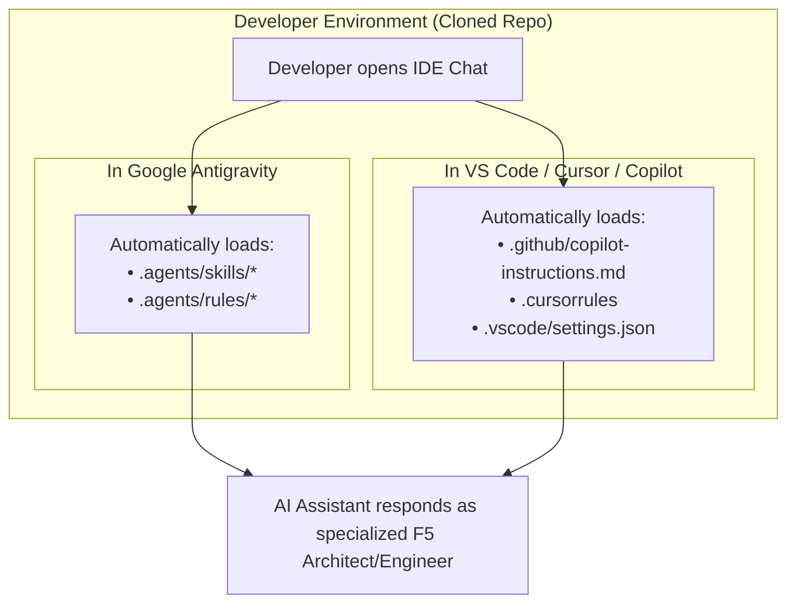

# AI Chat Prompt Playbook: Working with Antigravity, VS Code & Copilot
## Scope: Ready-to-Use Copy-Paste Prompts for F5 rSeries IaC Migration & Day-2 Operations

---

## 1. How IDE Chat Works Once This Repo Is Cloned

When any engineer clones this repository, the AI chat assistant in their IDE automatically acquires specialized F5 domain knowledge:



### In Google Antigravity:
* Antigravity natively indexes the 4 skills in `.agents/skills/`.
* You can prompt directly, or activate a persona by prefixing your prompt (e.g., *"As `migration-analyst`..."*).

### In Visual Studio Code (GitHub Copilot, Cursor, Continue.dev):
* Open Copilot Chat (`Cmd+Shift+I` on macOS, `Ctrl+Shift+I` on Windows/Linux) or the Chat side panel.
* Copilot and Cursor automatically ingest `.github/copilot-instructions.md` and `.cursorrules`.
* You can mention the persona directly in chat.

---

## 2. Copy-Paste Prompt Catalog by Lifecycle Phase

Here are ready-to-use prompt templates for every stage of your F5 rSeries migration and Day-2 operations. Copy, customize the bracketed values `[...]`, and paste into your IDE chat:

---

### Phase 1: Ingestion & Migration Assessment

#### Prompt 1.1: Full Assessment of a Legacy UCS Archive
```markdown
As migration-analyst, analyze our legacy iSeries backup file located at [path/to/my_legacy_backup.ucs].
1. Extract and parse the bigip.conf and bigip_gtm.conf files.
2. Run the deprecation audit to identify any insecure ciphers, COMPAT cipher suites, legacy HTTP monitor strings, or physical interface references.
3. Calculate whether this workload fits into our target r5900 tenant sizing budget for [i5800 / i7800].
4. Output the assessment report and generate the target AS3 declaration.
```

#### Prompt 1.2: Check iRule Compatibility for TMOS 17.x
```markdown
As migration-analyst, review the following legacy iRule from our iSeries appliance:

[PASTE YOUR IRULE CODE HERE]

Please audit it for deprecated TMOS syntax (such as matchclass, session commands, or unsupported hardware crypto commands) and rewrite it using modern TMOS 17.1.x declarative best practices.
```

#### Prompt 1.3: Convert Legacy Virtual Servers to AS3
```markdown
As migration-analyst, convert the following legacy TMOS virtual server and pool stanzas into an F5 AS3 v3.50+ JSON declaration:

[PASTE YOUR LTM VIRTUAL / POOL STANZA HERE]

Ensure the output uses Service_HTTPS with a valid TLS_Server profile, HTTP/1.1 monitor with 'Connection: Close', and proper member IP addresses.
```

---

### Phase 2: F5OS Physical Chassis & Hardware Platform

#### Prompt 2.1: Verify Hardware Sizing & Headroom on r5900
```markdown
As f5os-platform-architect, review our chassis configuration in environments/prod/chassis/pair-a/.
Verify our total vCPU and RAM allocations across all tenants against the r5900 hardware envelope:
- How many vCPUs are currently allocated to Tenant 1 (DNS) and Tenant 2 (LTM)?
- How many free vCPUs remain on the appliance for safety headroom?
- Is there capacity to add another 4-core tenant without violating the 28 vCPU guardrail?
```

#### Prompt 2.2: Add a New Trunk VLAN to the Physical Chassis
```markdown
As f5os-platform-architect, I need to add a new production VLAN [VLAN ID: 350, Name: vlan-payments] to both Pair-A and Pair-B:
1. Update environments/prod/chassis/pair-a/main.tf and pair-b/main.tf using the modules/f5os/vlan module.
2. Bind this VLAN to the physical LAG bundle-1.
3. Add VLAN 350 to the allowed_vlans list for the LTM tenant.
```

#### Prompt 2.3: Provision a 3rd Virtual Tenant on F5OS
```markdown
As f5os-platform-architect, write the Terraform configuration to provision a 3rd virtual tenant named [tenant-waf-edge] on r5900-A1:
- CPU cores: 4
- Memory: 16384 MB
- Management IP: 10.1.1.30/24, Gateway: 10.1.1.1
- Allowed VLANs: [100, 200]
Ensure it follows the modules/f5os/tenant module format and respects our hardware limits.
```

---

### Phase 3: Tenant Base Networking & HA Clustering (DO)

#### Prompt 3.1: Configure Active/Standby HA Sync-Failover Group
```markdown
As bigip-tenant-engineer, review environments/prod/tenants/pair-a/ltm/onboarding/main.tf.
Explain step-by-step how the Sync-Failover device group is established between LTM-A1 and LTM-A2:
- Which Self-IP is used for ConfigSync and network failover heartbeats?
- How is mutual device trust established?
- How does the floating Self-IP transition between nodes during a failover event?
```

#### Prompt 3.2: Add a New Self-IP and Route Domain
```markdown
As bigip-tenant-engineer, I need to configure a new Self-IP on the Pair-A LTM tenants for VLAN 350:
- Node A1 Self-IP: 10.1.350.11/24
- Node A2 Self-IP: 10.1.350.12/24
- Floating IP: 10.1.350.10/24 (traffic-group-1)
Update the do-networking module invocation in environments/prod/tenants/pair-a/ltm/onboarding/main.tf.
```

#### Prompt 3.3: Set Up DNS iQuery Mesh Trust
```markdown
As bigip-tenant-engineer, generate the exact CLI runbook commands to establish mutual iQuery (TCP port 4353) certificate trust using bigip_add between our 4 DNS tenants and our 4 LTM tenants across Pair-A and Pair-B.
```

---

### Phase 4: Application Delivery Services (AS3)

#### Prompt 4.1: Deploy a New HTTPS Application Service
```markdown
As bigip-tenant-engineer, add a new production HTTPS application service to environments/prod/tenants/pair-a/ltm/app-services/main.tf:
- App Name: vs_mobile_banking_https
- Virtual IP: 10.1.100.75:443
- Pool Members: 10.1.200.51:8443 and 10.1.200.52:8443
- Health Monitor: GET /api/health HTTP/1.1 with Host header and 200 OK receive string
- TLS: Offload with modern cipher suites and certificate reference
Use the modules/services/as3-http-app module.
```

#### Prompt 4.2: Attach a Declarative WAF/AWAF Policy
```markdown
As bigip-tenant-engineer, show me how to attach our enterprise WAF security policy to an existing virtual server using modules/services/as3-waf-policy.
Provide the updated Terraform snippet and explain how changes to the WAF policy URL are handled declaratively without traffic disruption.
```

---

### Phase 5: Day-2 Operations, Drift & Troubleshooting

#### Prompt 5.1: Check for Configuration Drift
```markdown
As iac-pipeline-sre, explain how we detect out-of-band configuration drift between our Terraform repository and our running F5OS chassis / TMOS tenants.
How can I run a drift check dry-run for Pair-A LTM without modifying active traffic?
```

#### Prompt 5.2: Simulate and Verify HA Failover Drill
```markdown
As bigip-tenant-engineer, walk me through conducting a controlled, zero-downtime failover drill on Pair-A LTM:
1. What tmsh commands should I run on LTM-A1 to verify pre-failover health?
2. What command initiates graceful standby transition?
3. How do I verify that LTM-A2 took over the floating VIPs without dropped packets?
```

#### Prompt 5.3: Emergency Rollback Procedure
```markdown
As iac-pipeline-sre, we are in the middle of cutover for application [vs_ecommerce_https] and the backend application team reports unexpected database timeouts.
Walk me through the immediate zero-downtime rollback procedure to revert traffic back to legacy iSeries appliances.
```

---

## 3. Summary Cheat-Sheet: Which Persona to Use

| Domain / Question | Persona Name | Key Keywords |
| :--- | :--- | :--- |
| **Physical Chassis, LAGs, Ports, vCPU/RAM Sizing** | `f5os-platform-architect` | F5OS, chassis, LAG, trunk, KVM, tenant size |
| **TMOS Networking, Self-IPs, HA Clustering, DNS** | `bigip-tenant-engineer` | DO, Self-IP, floating, failover, iQuery, GSLB |
| **Virtual Servers, Pools, Monitors, TLS, WAF** | `bigip-tenant-engineer` | AS3, Virtual Server, VIP, pool, monitor, cert |
| **Ingesting UCS, bigip.conf, Deprecation Audit** | `migration-analyst` | UCS, bigip.conf, deprecation, cipher, parse |
| **CI/CD, Pipelines, Terraform Drift, Vault Secrets** | `iac-pipeline-sre` | Pipeline, drift, tflint, schema, secrets, state |
