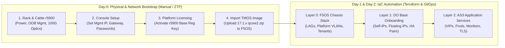

# Day-0 Hardware Commissioning & Network Pre-requisites Guide
## Scope: F5 r5900 Physical Appliances & Pre-IaC Bootstrap

---

## 1. Why Day-0 Pre-requisites Are Required

Terraform automation operates via the **F5OS-A RESTCONF API** (`https://<f5os-mgmt-ip>`) and TMOS REST APIs. Before Terraform can execute:
1. The 4 physical r5900 appliances must be racked, cabled, and powered on.
2. An Out-of-Band (OOB) Management IP must be assigned to each chassis control plane.
3. The chassis must be licensed and the target TMOS tenant `.qcow2.zip` image imported.
4. Top-of-Rack (ToR) network switches must have matching LACP trunk and VLAN configurations.



---

## 2. Physical Appliance Specifications & Cabling

### 2.1 Appliance Interfaces per r5900 Chassis
* **Management Port (`MGMT`)**: 1x 1000BASE-T RJ45 port connected to dedicated OOB management switch.
* **Console Port**: Micro-USB or RJ-45 serial (115200 baud, 8 data bits, no parity, 1 stop bit).
* **Data Plane Ports**:
  * Ports `1.0` and `2.0` (100GbE / 40GbE QSFP28) $\rightarrow$ Connected to ToR Switch Leaf 1 & Leaf 2.
  * Ports `3.0` – `10.0` (25GbE / 10GbE SFP28) $\rightarrow$ Available for local direct interconnects or sync.

### 2.2 Top-of-Rack (ToR) Switch Prerequisites
The upstream network switches (e.g. Cisco Nexus vPC, Arista MLAG, Juniper EVPN-ESI) must have corresponding configuration:
* **Port-Channel / LAG Mode**: LACP `active`, timer `fast` (1s) or `normal` (30s).
* **VLAN Trunking**: Allowed VLAN tags: `100` (External), `200` (Internal), `500` (DNS), `900` (HA Sync).
* **LACP Fallback / Individual**: Enabled on switch side if PXE/ZTP is used before LACP forms.

---

## 3. Day-0 Out-of-Band Setup Procedure (Step-by-Step)

### Step 1: Connect to Console or Default Management IP
* **Factory Default IP**: `192.168.1.245/24` on the `MGMT` interface.
* Or connect a laptop via USB console cable:
  ```bash
  screen /dev/tty.usbserial-* 115200
  ```

### Step 2: Run Initial Setup Utility
Log in with default credentials (`admin` / `admin` or prompt to set a new password):
```bash
# Set static management IP, gateway, and DNS on F5OS-A CLI
system management-ip 10.1.0.10/24 gateway 10.1.0.1
system dns servers [ 10.0.0.10 10.0.0.11 ]
```
Set initial admin password (minimum 16 characters, high entropy).

### Step 3: Platform Licensing & Registration Key Activation
Navigate to `https://10.1.0.10` in a browser or via CLI:
```bash
# Via F5OS CLI
system license activate registration-key <BASE-REG-KEY-XXXXX-XXXXX>
```
*Verify that the license status is `ACTIVE` and hardware entitlement covers TMOS tenant hosting.*

### Step 4: Import TMOS Tenant Base Image into F5OS
The Terraform tenant module requires the base TMOS image to exist in the F5OS image repository:
1. Download `BIGIP-17.1.1.3-0.0.5.ALL-F5OS.qcow2.zip` from [downloads.f5.com](https://downloads.f5.com).
2. Upload image to F5OS:
   ```bash
   # Via SCP to F5OS chassis
   scp BIGIP-17.1.1.3-0.0.5.ALL-F5OS.qcow2.zip admin@10.1.0.10:/var/F5/system/images/
   ```
3. Verify image is recognized:
   ```bash
   show images
   ```

---

## 4. Master Network IPAM & VLAN Allocation Matrix

Before executing Terraform, verify that network subnets and VLAN tags are reserved in your enterprise IPAM (e.g., Infoblox, NetBox):

### 4.1 Platform Out-of-Band (OOB) Management Subnets

| Physical Appliance / Tenant | Hostname | Role / Layer | Management IPv4 | Subnet Mask / Gateway |
| :--- | :--- | :--- | :--- | :--- |
| **`r5900-A1` Host** | `chassis-01a.corp.local` | F5OS-A Platform (Pair-A) | `10.1.0.10` | `255.255.255.0` (`10.1.0.1`) |
| **`r5900-A2` Host** | `chassis-01b.corp.local` | F5OS-A Platform (Pair-A) | `10.1.0.11` | `255.255.255.0` (`10.1.0.1`) |
| **`r5900-B1` Host** | `chassis-02a.corp.local` | F5OS-A Platform (Pair-B) | `10.2.0.10` | `255.255.255.0` (`10.2.0.1`) |
| **`r5900-B2` Host** | `chassis-02b.corp.local` | F5OS-A Platform (Pair-B) | `10.2.0.11` | `255.255.255.0` (`10.2.0.1`) |
| **`Tenant 1: DNS-A1`** | `dns-01a.corp.local` | TMOS Tenant on A1 | `10.1.1.10` | `255.255.255.0` (`10.1.1.1`) |
| **`Tenant 1: DNS-A2`** | `dns-01b.corp.local` | TMOS Tenant on A2 | `10.1.1.11` | `255.255.255.0` (`10.1.1.1`) |
| **`Tenant 2: LTM-A1`** | `ltm-01a.corp.local` | TMOS Tenant on A1 | `10.1.1.20` | `255.255.255.0` (`10.1.1.1`) |
| **`Tenant 2: LTM-A2`** | `ltm-01b.corp.local` | TMOS Tenant on A2 | `10.1.1.21` | `255.255.255.0` (`10.1.1.1`) |
| **`Tenant 1: DNS-B1`** | `dns-02a.corp.local` | TMOS Tenant on B1 | `10.2.1.10` | `255.255.255.0` (`10.2.1.1`) |
| **`Tenant 1: DNS-B2`** | `dns-02b.corp.local` | TMOS Tenant on B2 | `10.2.1.11` | `255.255.255.0` (`10.2.1.1`) |
| **`Tenant 2: LTM-B1`** | `ltm-02a.corp.local` | TMOS Tenant on B1 | `10.2.1.20` | `255.255.255.0` (`10.2.1.1`) |
| **`Tenant 2: LTM-B2`** | `ltm-02b.corp.local` | TMOS Tenant on B2 | `10.2.1.21` | `255.255.255.0` (`10.2.1.1`) |

---

### 4.2 Data Plane VLAN & Self-IP Matrix

#### Pair-A (Primary Site / Data Center 1):
| VLAN Name | 802.1Q Tag | Subnet CIDR | Default Gateway | Self-IP Node A1 | Self-IP Node A2 | Floating VIP / Self-IP | Purpose |
| :--- | :--- | :--- | :--- | :--- | :--- | :--- | :--- |
| **`vlan-external`** | 100 | `10.1.100.0/24` | `10.1.100.1` | `10.1.100.11` | `10.1.100.12` | `10.1.100.10` (Float) | Ingress traffic, Public VIPs |
| **`vlan-internal`** | 200 | `10.1.200.0/24` | `10.1.200.1` | `10.1.200.11` | `10.1.200.12` | `10.1.200.10` (Float) | Egress backend pool member traffic |
| **`vlan-dns-anycast`**| 500 | `10.1.50.0/24` | `10.1.50.1` | `10.1.50.11` | `10.1.50.12` | `10.1.50.53` (Anycast VIP) | DNS UDP/TCP 53 & iQuery 4353 |
| **`vlan-ha-sync`** | 900 | `10.1.900.0/24` | N/A (Isolated) | `10.1.900.11` | `10.1.900.12` | N/A | LTM ConfigSync & Network Failover |

#### Pair-B (Secondary Site / Data Center 2):
| VLAN Name | 802.1Q Tag | Subnet CIDR | Default Gateway | Self-IP Node B1 | Self-IP Node B2 | Floating VIP / Self-IP | Purpose |
| :--- | :--- | :--- | :--- | :--- | :--- | :--- | :--- |
| **`vlan-external`** | 100 | `10.2.100.0/24` | `10.2.100.1` | `10.2.100.11` | `10.2.100.12` | `10.2.100.10` (Float) | Ingress traffic, Public VIPs |
| **`vlan-internal`** | 200 | `10.2.200.0/24` | `10.2.200.1` | `10.2.200.11` | `10.2.200.12` | `10.2.200.10` (Float) | Egress backend pool member traffic |
| **`vlan-dns-anycast`**| 500 | `10.2.50.0/24` | `10.2.50.1` | `10.2.50.11` | `10.2.50.12` | `10.2.50.53` (Anycast VIP) | DNS UDP/TCP 53 & iQuery 4353 |
| **`vlan-ha-sync`** | 900 | `10.2.900.0/24` | N/A (Isolated) | `10.2.900.11` | `10.2.900.12` | N/A | LTM ConfigSync & Network Failover |

---

## 5. Readiness Checklist Before Running Terraform Layer 0

Before running `terraform apply` in `environments/prod/chassis/pair-a/`:

- [ ] All 4 r5900 appliances powered on with dual power feeds green.
- [ ] Management interfaces reachable via HTTPS from Terraform pipeline agent / runner:
  ```bash
  curl -k -I https://10.1.0.10/restconf/data/f5-tenants:tenants
  ```
- [ ] Admin password verified and stored in HashiCorp Vault.
- [ ] Physical optics (QSFP28 100G) connected to ToR switches; link lights green.
- [ ] ToR switch LACP port-channel configured for ports `1.0` and `2.0`.
- [ ] Base TMOS image `BIGIP-17.1.1.3-0.0.5.ALL-F5OS.qcow2.zip` uploaded to `/var/F5/system/images/`.
- [ ] IPAM reservations confirmed for all Self-IPs and Floating VIPs above.
