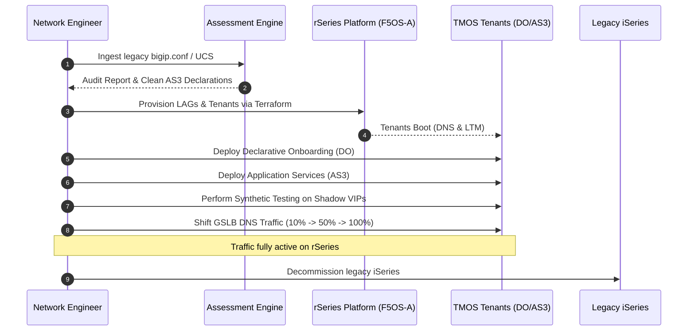

# Production Migration Runbook: Side-by-Side Migration from iSeries to rSeries

---

## 1. Migration Strategy: Side-by-Side Parallel Cutover

This runbook documents the **zero-downtime side-by-side migration** model. The new 4x r5900 appliances (Pair-A & Pair-B) run concurrently alongside legacy iSeries appliances. Traffic is gradually cut over using GSLB DNS ratio weights or Anycast route manipulation.



---

## 2. Phase-by-Phase Execution

### Phase -1: Day-0 Hardware & Network Commissioning (Prerequisites)
* **Responsible Role**: Data Center Network Engineer & `f5os-platform-architect`
* **Prerequisites Guide**: [docs/hardware-commissioning-prerequisites.md](file:///Users/hl/Documents/antigravity/IaC%20F5/docs/hardware-commissioning-prerequisites.md)
* **Checklist**:
  1. Rack, dual-power, and cable all 4 physical appliances (`r5900-A1`, `A2`, `B1`, `B2`).
  2. Complete console setup: assign static OOB management IPs (`10.1.0.10`, `10.1.0.11`, `10.2.0.10`, `10.2.0.11`), default gateways, and admin passwords.
  3. Activate F5OS base registration keys and verify licensing.
  4. Upload TMOS tenant base image (`BIGIP-17.1.1.3-0.0.5.ALL-F5OS.qcow2.zip`) to F5OS image repository.
  5. Reserve network subnets, VLAN IDs (100, 200, 500, 900), and Self-IPs in IPAM per the [Master IPAM Matrix](file:///Users/hl/Documents/antigravity/IaC%20F5/docs/hardware-commissioning-prerequisites.md#4-master-network-ipam--vlan-allocation-matrix).

---

### Phase 0: Discovery & Assessment
* **Responsible Agent Persona**: `migration-analyst`
* **Agent Prompt Example**: *"As `migration-analyst`, ingest `/var/local/ucs/legacy_backup.ucs`, audit for deprecations, and verify r5900 sizing."*

1. Export UCS archive from legacy iSeries:
   ```bash
   tmsh save sys ucs /var/local/ucs/legacy_backup.ucs
   ```
2. Run assessment tool (or press `Cmd+Shift+B` in VS Code):
   ```bash
   python3 tools/assessment/run_assessment.py --config /path/to/legacy_backup.ucs --model i5800 --output ./migration_audit/
   ```
3. Review `migration_assessment_report.md` for `CRITICAL` or `HIGH` deprecations (e.g. COMPAT cipher strings, deprecated iRules, bare physical interface bindings).
4. Verify r5900 tenant sizing budget in `migration_inventory.json`.

---

### Phase 1: Physical Appliance & Platform Deployment (F5OS-A)
* **Responsible Agent Persona**: `f5os-platform-architect`
* **Agent Prompt Example**: *"As `f5os-platform-architect`, review and plan the F5OS chassis configuration in `environments/prod/chassis/pair-a/`."*

1. Rack and cable all 4 physical appliances (`r5900-A1`, `A2`, `B1`, `B2`).
2. Deploy F5OS platform layer for Pair-A (or run VS Code Task `Terraform: Plan Pair-A Chassis`):
   ```bash
   cd environments/prod/chassis/pair-a
   terraform init
   terraform plan -out=tfplan
   terraform apply tfplan
   ```
3. Repeat for Pair-B:
   ```bash
   cd environments/prod/chassis/pair-b
   terraform init && terraform apply
   ```
4. Verify tenant container health on F5OS:
   ```bash
   curl -k -u admin:password https://10.1.0.10/restconf/data/f5-tenants:tenants-state
   ```

---

### Phase 2: Tenant Declarative Onboarding (DO)
* **Responsible Agent Persona**: `bigip-tenant-engineer`
* **Agent Prompt Example**: *"As `bigip-tenant-engineer`, deploy base networking and establish the Active/Standby HA pair between LTM-A1 and LTM-A2."*

1. Onboard Pair-A LTM HA pair (`LTM-A1` & `LTM-A2`):
   ```bash
   cd environments/prod/tenants/pair-a/ltm/onboarding
   terraform init && terraform apply
   ```
2. Verify Device Group status:
   ```bash
   ssh admin@10.1.1.20 "tmsh show cm sync-status"
   ```
   *Expected Output*: `Status: In Sync`
3. Onboard Pair-A DNS nodes:
   ```bash
   cd environments/prod/tenants/pair-a/dns/onboarding
   terraform init && terraform apply
   ```
4. Repeat for Pair-B LTM and DNS onboarding stacks.

---

### Phase 3: Application Services (AS3) Shadow Deployment
* **Responsible Agent Persona**: `bigip-tenant-engineer`
* **Agent Prompt Example**: *"As `bigip-tenant-engineer`, deploy the AS3 declarations for eCommerce and API gateway into `environments/prod/tenants/pair-a/ltm/app-services/`."*

1. Deploy AS3 configurations generated from Stage 2 into the active LTM tenant:
   ```bash
   cd environments/prod/tenants/pair-a/ltm/app-services
   terraform init && terraform apply
   ```
2. Verify Virtual Server and Pool status in TMOS:
   ```bash
   ssh admin@10.1.1.20 "tmsh show ltm virtual"
   ssh admin@10.1.1.20 "tmsh show ltm pool"
   ```

---

### Phase 4: Non-Disruptive Pre-Cutover Verification
* **Responsible Agent Persona**: `iac-pipeline-sre`
* **Agent Prompt Example**: *"As `iac-pipeline-sre`, run synthetic health probes against shadow VIPs 10.1.100.50 and 10.1.100.60."*

1. Test shadow VIP endpoints directly from test hosts using `curl` with `--resolve`:
   ```bash
   curl -vk --resolve ecommerce.corp.local:443:10.1.100.50 https://ecommerce.corp.local/health
   curl -vk --resolve api.corp.local:443:10.1.100.60 https://api.corp.local/health
   ```
2. Validate backend server response and SSL certificate validity.

---

### Phase 5: Traffic Cutover & Canary Shift
1. **Canary Shift (10%)**: Update GSLB WideIP pool ratio weights to direct 10% of DNS traffic to the new r5900 Virtual Servers.
2. Monitor metrics for 30 minutes:
   - Connection success rate
   - CPU and memory on r5900 tenants
   - Backend pool latency
3. **Full Shift (100%)**: Transition 100% of traffic to the r5900 appliances.

---

### Phase 6: Post-Cutover & Rollback Plan

#### Rollback Procedure (If critical degradation occurs):
1. Immediately re-point GSLB WideIP ratio back to 100% on legacy iSeries VIPs.
2. Flush client DNS caches.
3. Traffic returns to legacy appliances within seconds without data loss.

#### Decommissioning:
1. Allow legacy iSeries appliances to run in cold standby for 7 days.
2. Archive legacy configuration and power down appliances.
